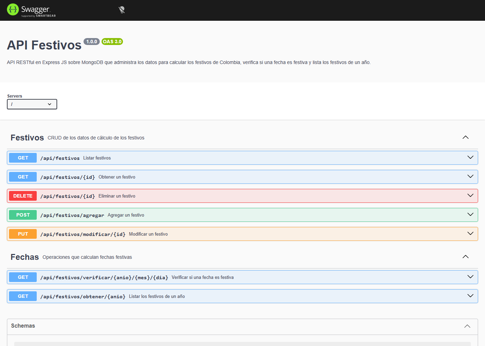
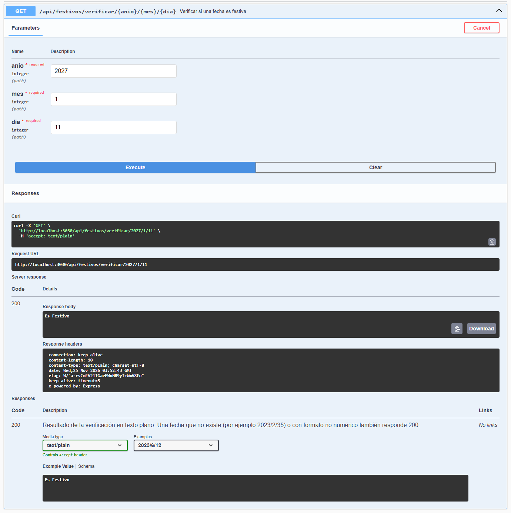
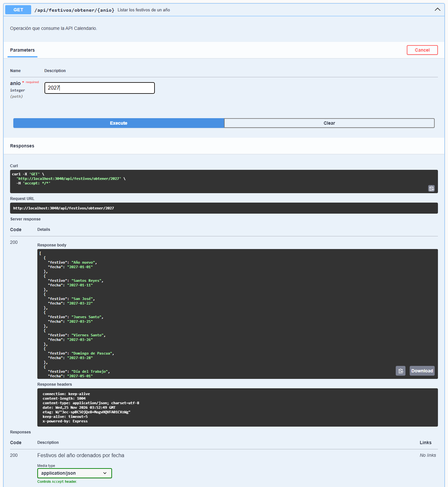
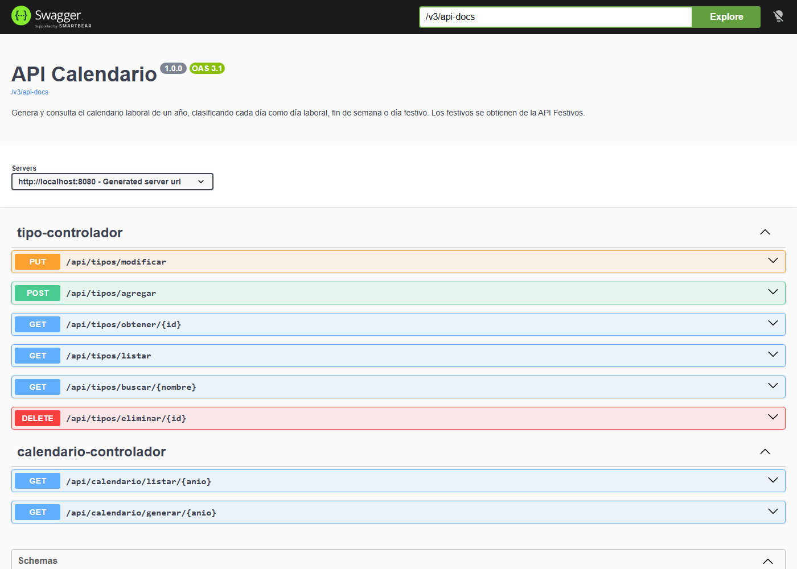
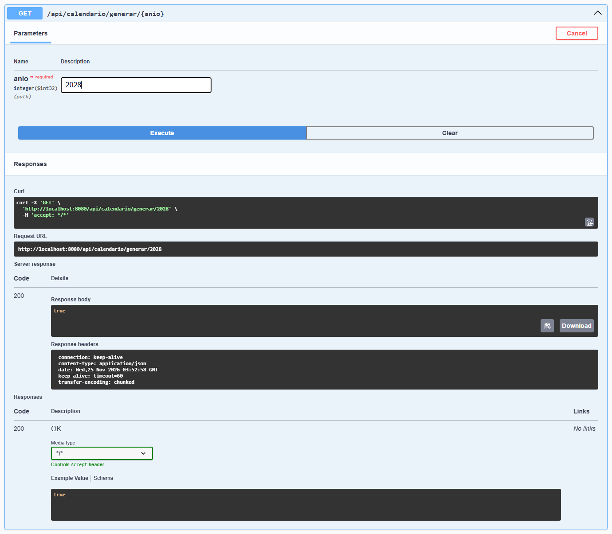
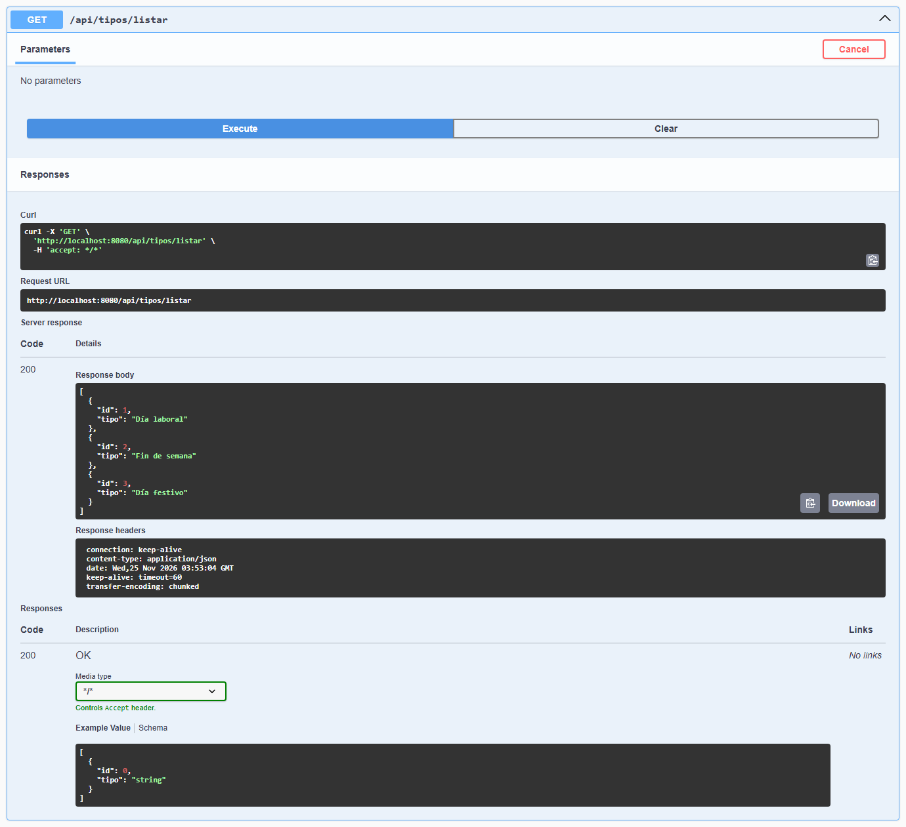
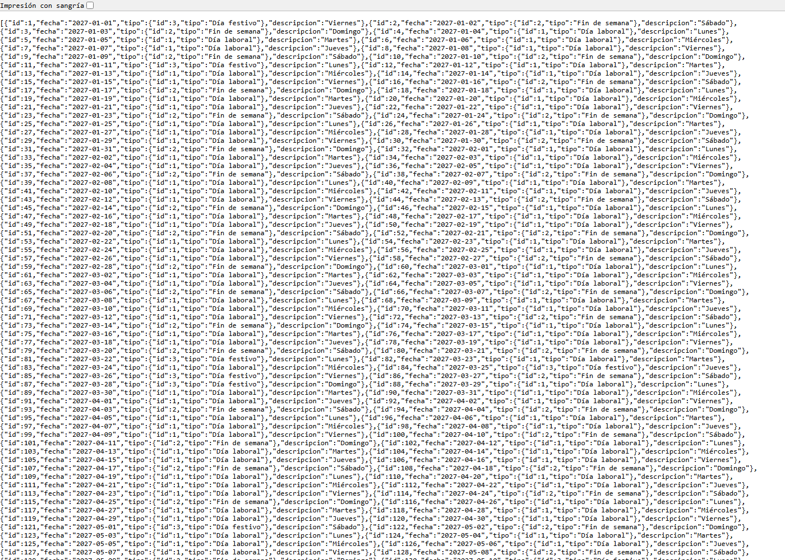

# Evidencias de ejecución

Pruebas de la orquestación con Docker Compose de la **API Festivos** (Express JS + MongoDB) y
la **API Calendario** (Spring Boot + PostgreSQL). Todas las salidas y capturas de este
documento son de una ejecución real del [docker-compose.yml](docker-compose.yml) de este
repositorio.

**Entorno:** Windows 11 Pro, Docker Desktop con Docker Engine 28.5.1 y Docker Compose
v2.40.2. Las pruebas se hicieron con `curl` y con Swagger UI.

**Contenido:**

1. [Construcción y arranque](#1-construcción-y-arranque)
2. [Red, volúmenes e imágenes](#2-red-volúmenes-e-imágenes)
3. [Bases de datos](#3-bases-de-datos)
4. [API Festivos](#4-api-festivos)
5. [API Calendario e integración entre las APIs](#5-api-calendario-e-integración-entre-las-apis)
6. [Otros comandos de Docker Compose](#6-otros-comandos-de-docker-compose)
7. [Resumen](#7-resumen)

## 1. Construcción y arranque

Con las imágenes construidas desde cero (`docker compose build --no-cache`), se levanta todo
en segundo plano desde la raíz del repositorio:

```text
$ docker compose up -d
 Network red-calendario  Created
 Volume festivos-calendario_datos-festivos  Created
 Volume festivos-calendario_datos-calendario  Created
 Container dockerbdfestivos  Created
 Container dockerbdcalendario  Created
 Container dockerapifestivos  Created
 Container dockerapicalendario  Created
 Container dockerbdfestivos  Started
 Container dockerbdcalendario  Started
 Container dockerbdfestivos  Healthy
 Container dockerapifestivos  Started
 Container dockerbdcalendario  Healthy
 Container dockerapicalendario  Started
```

El orden lo decide Compose con `depends_on`: las bases de datos arrancan primero, la API
Festivos espera a que MongoDB esté sano (`Healthy`) y la API Calendario espera a que
PostgreSQL esté sano.

Los cuatro contenedores quedan en ejecución y sanos (`healthy`), cada uno con su puerto
publicado en el equipo:

```text
$ docker compose ps
NAME                  IMAGE                 STATUS                    PORTS
dockerapicalendario   dockerapicalendario   Up 15 seconds (healthy)   0.0.0.0:8080->8080/tcp
dockerapifestivos     dockerapifestivos     Up 16 seconds (healthy)   0.0.0.0:3030->3030/tcp
dockerbdcalendario    dockerbdcalendario    Up 22 seconds (healthy)   0.0.0.0:5433->5432/tcp
dockerbdfestivos      dockerbdfestivos      Up 22 seconds (healthy)   0.0.0.0:27018->27017/tcp
```

## 2. Red, volúmenes e imágenes

Los cuatro contenedores están en la red `red-calendario`, donde cada uno encuentra a los
demás por su nombre:

```text
$ docker network inspect red-calendario
red-calendario (driver bridge)
  dockerapicalendario  172.21.0.5/16
  dockerbdcalendario  172.21.0.3/16
  dockerbdfestivos  172.21.0.2/16
  dockerapifestivos  172.21.0.4/16
```

Los datos de cada base de datos se guardan en su propio volumen:

```text
$ docker volume ls
DRIVER    VOLUME NAME
local     festivos-calendario_datos-calendario
local     festivos-calendario_datos-festivos
```

Imágenes construidas por Compose a partir de los Dockerfiles del repositorio:

```text
$ docker images
REPOSITORY            TAG       SIZE
dockerapicalendario   latest    373MB
dockerapifestivos     latest    286MB
dockerbdcalendario    latest    636MB
dockerbdfestivos      latest    1.29GB
```

## 3. Bases de datos

### MongoDB (`dockerbdfestivos`)

El script de datos se cargó al arrancar el contenedor: la colección `tipos` tiene los 4 tipos
con sus 19 festivos.

```text
$ docker exec dockerbdfestivos mongosh --quiet festivos --eval "..."
1 | Fijo | 6 festivos
2 | Ley de Puente festivo | 7 festivos
3 | Basado en el domingo de pascua | 3 festivos
4 | Basado en el domingo de pascua y Ley de Puente festivo | 3 festivos
```

Desde el equipo, por el puerto publicado `27018` (el mismo que se usa en MongoDB Compass),
con el driver de MongoDB para Node.js:

```text
mongodb://localhost:27018 -> base festivos, colección tipos: 4 documentos
```

### PostgreSQL (`dockerbdcalendario`)

El DDL creó la base de datos `calendario` con sus tablas, y el DML cargó el catálogo de
tipos:

```text
$ docker exec dockerbdcalendario psql -U postgres -d calendario -c "SELECT * FROM tipo;"
 id |     tipo
----+---------------
  1 | Día laboral
  2 | Fin de semana
  3 | Día festivo
(3 rows)
```

Desde el equipo, por el puerto publicado `5433` (el mismo que se usa en pgAdmin):

```text
$ psql -h localhost -p 5433 -U postgres -d calendario -c "SELECT table_name FROM information_schema.tables WHERE table_schema = 'public' ORDER BY 1;"
 table_name
------------
 calendario
 tipo
(2 filas)
```

## 4. API Festivos

### Verificar una fecha

Los tres casos del enunciado responden el texto esperado:

```text
$ curl localhost:3030/api/festivos/verificar/2023/6/12
Es Festivo

$ curl localhost:3030/api/festivos/verificar/2023/2/28
No es festivo

$ curl localhost:3030/api/festivos/verificar/2023/2/35
Fecha No valida
```

### Festivos de un año

Es la operación que consume la API Calendario. Para 2027 calcula los 19 festivos, con los
traslados al lunes y las fechas basadas en el domingo de Pascua (28 de marzo de 2027):

```text
$ curl localhost:3030/api/festivos/obtener/2027
2027-01-01   Año nuevo
2027-01-11   Santos Reyes
2027-03-22   San José
2027-03-25   Jueves Santo
2027-03-26   Viernes Santo
2027-03-28   Domingo de Pascua
2027-05-01   Día del Trabajo
2027-05-10   Ascensión del Señor
2027-05-31   Corpus Christi
2027-06-07   Sagrado Corazón de Jesús
2027-07-05   San Pedro y San Pablo
2027-07-20   Independencia Colombia
2027-08-07   Batalla de Boyacá
2027-08-16   Asunción de la Virgen
2027-10-18   Día de la Raza
2027-11-01   Todos los santos
2027-11-15   Independencia de Cartagena
2027-12-08   Inmaculada Concepción
2027-12-25   Navidad
Total: 19 festivos
```

(La respuesta real es JSON, `[{"festivo":"Año nuevo","fecha":"2027-01-01"}, ...]`; aquí se
muestra en columnas para leerla mejor.)

### Swagger UI

Swagger UI de la API Festivos en `http://localhost:3030/api-docs`:



"Try it out" de verificar con el 11 de enero de 2027 (Santos Reyes, trasladado al lunes):



Swagger UI ya no tiene fija la URL `http://localhost:3030`, así que también funciona si el
contenedor se publica en otro puerto. Para comprobarlo se levantó una copia temporal de la
imagen `dockerapifestivos` publicada en el puerto `3040`, como en el ejemplo de clase. La
prueba sale hacia `http://localhost:3040` y responde 200:



## 5. API Calendario e integración entre las APIs

### Catálogo de tipos

```text
$ curl localhost:8080/api/tipos/listar
[{"id":1,"tipo":"Día laboral"},{"id":2,"tipo":"Fin de semana"},{"id":3,"tipo":"Día festivo"}]
```

### Generar el calendario de 2027

Antes de generar, la tabla `calendario` está vacía:

```text
$ docker exec dockerbdcalendario psql -U postgres -d calendario -c "SELECT COUNT(*) AS dias FROM calendario;"
 dias
------
    0
(1 row)
```

Al generar, la API Calendario pide los festivos de 2027 a la API Festivos por la red de
Docker (`http://dockerapifestivos:3030/api/festivos/obtener/2027`), clasifica los 365 días y
los guarda en PostgreSQL:

```text
$ curl localhost:8080/api/calendario/generar/2027
true
```

```text
$ curl localhost:8080/api/calendario/listar/2027
[
  {"id": 1, "fecha": "2027-01-01", "tipo": {"id": 3, "tipo": "Día festivo"},   "descripcion": "Viernes"},
  {"id": 2, "fecha": "2027-01-02", "tipo": {"id": 2, "tipo": "Fin de semana"}, "descripcion": "Sábado"},
  {"id": 3, "fecha": "2027-01-03", "tipo": {"id": 2, "tipo": "Fin de semana"}, "descripcion": "Domingo"},
  ...
]
... total: 365 días
```

En PostgreSQL quedan los 365 días: 19 festivos, 100 de fin de semana y 246 laborales.

```text
$ docker exec dockerbdcalendario psql -U postgres -d calendario -c "SELECT t.tipo, COUNT(*) AS dias FROM calendario c JOIN tipo t ON t.id = c.idtipo WHERE c.fecha BETWEEN '2027-01-01' AND '2027-12-31' GROUP BY t.tipo ORDER BY t.tipo;"
     tipo      | dias
---------------+------
 Día festivo   |   19
 Día laboral   |  246
 Fin de semana |  100
(3 rows)
```

Los días guardados como *Día festivo* son exactamente los 19 que entregó la API Festivos (ver
la [sección 4](#festivos-de-un-año)). Esa información no está en la base de datos del
calendario: llegó por la integración entre los dos contenedores. Un festivo que cae en fin de
semana se guarda como festivo (por ejemplo el 1 de mayo, sábado).

```text
$ docker exec dockerbdcalendario psql -U postgres -d calendario -c "SELECT fecha, descripcion FROM calendario WHERE idtipo = 3 AND fecha BETWEEN '2027-01-01' AND '2027-12-31' ORDER BY fecha;"
   fecha    | descripcion
------------+-------------
 2027-01-01 | Viernes
 2027-01-11 | Lunes
 2027-03-22 | Lunes
 2027-03-25 | Jueves
 2027-03-26 | Viernes
 2027-03-28 | Domingo
 2027-05-01 | Sábado
 2027-05-10 | Lunes
 2027-05-31 | Lunes
 2027-06-07 | Lunes
 2027-07-05 | Lunes
 2027-07-20 | Martes
 2027-08-07 | Sábado
 2027-08-16 | Lunes
 2027-10-18 | Lunes
 2027-11-01 | Lunes
 2027-11-15 | Lunes
 2027-12-08 | Miércoles
 2027-12-25 | Sábado
(19 rows)
```

### Swagger UI

Swagger UI de la API Calendario en `http://localhost:8080/swagger-ui.html`:



Generar el calendario de 2028 desde Swagger UI responde `true`:



Listar los tipos de día desde Swagger UI:



Calendario de 2027 consultado desde el navegador (`http://localhost:8080/api/calendario/listar/2027`):



## 6. Otros comandos de Docker Compose

### Reconstruir y relanzar un solo servicio

Después de un cambio en la API Festivos se reconstruye solo ese servicio (y lo que necesita
para arrancar, su base de datos). La API Calendario y PostgreSQL siguen corriendo sin
tocarse:

```text
$ docker compose up -d --build apifestivos
dockerbdfestivos  Built
dockerapifestivos  Built
Container dockerbdfestivos  Recreated
Container dockerapifestivos  Recreated
Container dockerbdfestivos  Started
Container dockerbdfestivos  Healthy
Container dockerapifestivos  Started
```

### Caída de la API Festivos

Se detiene solo la API Festivos. La API Calendario no se cae: generar responde `false`
porque no puede obtener los festivos, pero el calendario ya generado y el CRUD de tipos
siguen respondiendo.

```text
$ docker compose stop apifestivos
Container dockerapifestivos  Stopping
Container dockerapifestivos  Stopped

$ docker compose ps -a
NAME                  STATUS
dockerapicalendario   Up 2 minutes (healthy)
dockerapifestivos     Exited (143) Less than a second ago
dockerbdcalendario    Up 2 minutes (healthy)
dockerbdfestivos      Up 2 minutes (healthy)

$ curl localhost:8080/api/calendario/generar/2030    # API Festivos detenida
false

$ curl localhost:8080/api/tipos/listar               # el resto de la API Calendario responde
[{"id":1,"tipo":"Día laboral"},{"id":2,"tipo":"Fin de semana"},{"id":3,"tipo":"Día festivo"}]

$ curl localhost:8080/api/calendario/listar/2027  -> 365 días
```

El código 143 indica que la API Festivos se apagó de forma normal con la señal de apagado
(gracias a `init: true`). El log de la API Calendario registra por qué no pudo generar:

```text
$ docker compose logs apicalendario | grep "No se pudo generar"
2026-11-25T03:57:58.876Z ERROR 1 --- [apicalendario] [nio-8080-exec-8] a.presentacion.CalendarioControlador : No se pudo generar el calendario del año 2030
```

Al arrancar de nuevo la API Festivos, generar vuelve a responder `true`. En la primera
llamada, justo después de arrancar, todavía respondió `false`: la API Calendario guarda unos
segundos el fallo al resolver el nombre `dockerapifestivos`. Cuatro segundos después ya
respondió `true`:

```text
$ docker compose start apifestivos
Container dockerbdfestivos  Waiting
Container dockerbdfestivos  Healthy
Container dockerapifestivos  Starting
Container dockerapifestivos  Started

22:58:06 $ curl localhost:8080/api/calendario/generar/2030
false
22:58:10 $ curl localhost:8080/api/calendario/generar/2030
true
```

### Persistencia de los datos

`docker compose down` elimina los contenedores y la red, pero conserva los volúmenes. Al
levantar de nuevo, los calendarios generados antes siguen ahí (2028 es bisiesto):

```text
$ docker compose down
Container dockerapicalendario  Removed
Container dockerbdcalendario  Removed
Container dockerapifestivos  Removed
Container dockerbdfestivos  Removed
Network red-calendario  Removed

$ docker compose up -d
...
$ docker compose ps
NAME                  STATUS
dockerapicalendario   Up 7 seconds (healthy)
dockerapifestivos     Up 8 seconds (healthy)
dockerbdcalendario    Up 13 seconds (healthy)
dockerbdfestivos      Up 13 seconds (healthy)

listar/2027 -> 365 días
listar/2028 -> 366 días
listar/2029 -> 365 días
```

Para empezar desde cero se usa `docker compose down -v`, que además borra los volúmenes:
en el siguiente `docker compose up` las bases de datos se crean y se cargan otra vez con sus
scripts.

## 7. Resumen

| Prueba | Resultado |
|---|---|
| Construir las 4 imágenes y levantar los 4 contenedores con un solo comando | Correcto |
| Los 4 contenedores quedan sanos (`healthcheck`) | Correcto |
| MongoDB y PostgreSQL cargan sus scripts al arrancar con el volumen vacío | Correcto |
| Bases de datos accesibles desde el equipo (puertos `27018` y `5433`) | Correcto |
| API Festivos: los tres casos de verificar del enunciado | Correcto |
| API Festivos: festivos de 2027 | Correcto (19 festivos) |
| Swagger UI de las dos APIs, incluso con la API Festivos en otro puerto (`3040`) | Correcto |
| Integración: generar el calendario de 2027 con los festivos de la otra API | Correcto (365 días, 19 festivos) |
| Año bisiesto (2028) | Correcto (366 días) |
| Reconstruir un solo servicio | Correcto |
| Caída de la API Festivos: la API Calendario sigue respondiendo | Correcto |
| Los datos se conservan después de `docker compose down` | Correcto |
